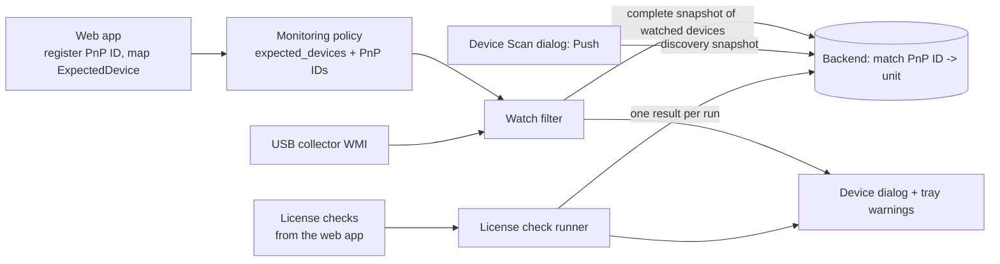

# Bench device and license monitoring (agent design)

**Status:** Devices: implemented end to end (registered PnP IDs, watch list, discovery; agent, backend and web app). License checks: implemented in the agent; backend routes pending. Backend contract: lab-mango
`docs/proposals/agent-bench-devices-and-licenses.md` (T2, needs owner approval).
**Builds on:** the USB collector and `DeviceObservationReporter` (`src/core/monitoring/`).

## 1. Goals

1. Monitor only the equipment mapped to this computer (its expected devices). Mice, keyboards,
   phones and personal sticks never leave the computer.
2. Identify equipment by the PnP ID Windows reports, registered on the inventory unit, not by the
   inventory's `serial_number`, which is typed by people (part numbers, labels).
3. Read tool licenses held by lab hardware or by the computer (first: Vector), so the backend
   keeps `License.expiry_date` / `max_version` current and warns before expiry.
4. Show both in the tray app: warnings and the device dialog.

## 2. Identity: registered PnP IDs

What the agent can read for a device is its **PnP device instance ID** (`Win32_PnPEntity.PNPDeviceID`;
Device Manager → Details → *Device instance path*), e.g. `USB\VID_1248&PID_1073\007113-585343`.
A coordinator registers that ID on the inventory unit once (`EquipmentHardwareId`, kind `pnp_id`;
backend proposal, section 3.1). `Equipment.serial_number` stays a human label and is never used.

| PnP ID | Example | Valid |
|---|---|---|
| With a USB serial | `USB\VID_0403&PID_6001\A12BC3` | on any port and computer |
| Without (Windows adds `&…`) | `USB\VID_046D&PID_C52B\5&2A3C0F1&0&2` | on that USB port of that computer only (registered with the computer) |

A Vector license names its carrier by Vector device name (`DeviceName`, e.g. `007113-585343`). The
CANcase therefore gets a second ID, kind `vector_device`, registered from the License Client. If the
Vector PnP instance path ends with the same name (to check once in Device Manager), the agent can
add it itself and the second registration is not needed.

## 3. What the agent reports

This is the earlier agent's model, kept: the backend maps equipment to computers
(`ExpectedDevice`); the agent pulls that list with its PnP IDs and reports changes.

| Device | Reported | Backend sees |
|---|---|---|
| PnP ID on the watch list (`expected_devices`) | yes, connected | the expected unit: present |
| Watched unit not connected | absent from the complete snapshot | the expected unit: missing (alert if `notify_on_disconnect`) |
| Anything else | no | — |
| All connected devices, on an admin's **Push** in the Device Scan dialog | once, as a discovery snapshot | unlinked devices a coordinator can **Link** (registers the PnP ID) |

Snapshots are sent on change (3-scan debounce, 5 s scans) and every half `freshness_seconds`; each
observation carries `hardware_ids: [{kind: "pnp_id", value}]`. Additional devices (lab equipment
models from another bench) are a later phase (`device_models`).



The legacy model (report every device, match by serial number) is removed. A discovery snapshot
offers only USB devices that are not on the watch list; the backend treats it as link evidence only
(never presence, reporting or alerts).

## 4. Collectors

| Collector | Source | Reports | Needs |
|---|---|---|---|
| `pnp` | WMI `Win32_PnPEntity` every 5 s, 3-scan debounce | devices on the watch list, by PnP ID | — |
| `discovery` | same scan, on Push | all connected devices, once | admin login |
| license checks | configured per computer in the web app (presets: Vector License Client) | licenses per carrier, one result per run | see 4.2 |

### 4.1 Vector devices

No separate Vector device reader is needed: a CANcase is a USB device with a PnP ID like any other.
Only its license-carrier name (`vector_device`) has to be registered once, unless its instance path
ends with that name (section 2).

### 4.2 License checks

Licenses are read by **license checks** configured in the Lab Mango web app (backend proposal,
section 5). The agent implements a closed catalog of read-only probes; a check is data only:

| Part | Options |
|---|---|
| Probe | `command` (installed tool, fixed args, stdout), `file` (license/status file), `registry` (values under one HKLM key) |
| Extraction | `xml` (ElementTree path), `json` (dotted path with `[*]`), `text` (regex with named groups), `values` (registry); field sources for product, product code, version, expiry, final expiry, carrier ID, vendor license ID, reactivatable, carrier type; date formats; "never" values |
| Carrier | `computer`, `device` / `dongle` (hardware ID kind + `carrier_id`), `server`, `equipment` (unit chosen in the web app), or `mapped` per license from a tool field |

**Push by license serial.** The agent does not decide which Lab Mango license a result belongs to:
it pushes every license it finds with its `license_serial` (the tool's own license ID) and carrier;
the backend finds the `License` whose `serial_number` is that serial, compares expiry, version and
carrier, and updates it (backend proposal, section 5.4). The observation key is built from the
serial, so a license keeps its identity when its dongle or device moves to another computer.

**License keys are never read.** `serial_number` (visible) and `identifier` (the secret license key)
are separate fields in Lab Mango. The agent only reports what identifies and describes a license;
reading activation keys from tools or files is out of scope by design: they are not needed to match,
and copying them to a server would widen who can steal them.
Licenses without a serial fall back to product-code matching on the backend.

The backend updates a license only if the report is plausible for this computer: the carrier is this
computer, a unit placed on its bench, or a unit this computer's agent reports as **connected** in its
device observations; and the license is assigned to that carrier or to this computer (backend
proposal, section 5.4, decision D8). For a license on a CANcase borrowed from another bench, the
"connected" rule is what applies: the CANcase must be registered with its PnP ID (so this computer
reports it connected) and its Vector device name (so the license finds it), section 2.

Where the checks come from: `GET /agent/license-checks` when the backend advertises
`license_checks`; until then the presets enabled in `licenses.builtin_checks` (local settings).
Each check runs on its own interval (≥ 15 minutes); the scheduler wakes every 15 minutes. A changed
`revision` runs at once. A failed run keeps the last known licenses for the UI and reports the
failure; only an `ok` run replaces the license set.

**Local safety rules** (`src/core/licensing/probes.py`), not overridable by the backend:

| Rule | Detail |
|---|---|
| No shell | `subprocess.run([exe, *args])`, no window, stdin closed, cwd = tool folder |
| Bounds | ≤ 16 args of ≤ 256 chars, timeout ≤ 60 s, output and files ≤ 4 MiB, ≤ 500 licenses |
| Folders | Executables and files: absolute, under Program Files, Program Files (x86), ProgramData or `licenses.allowed_roots` |
| Untrusted connection | While `tls.verify` is off, configured paths are refused (`rejected` / `untrusted_connection`) unless they are trusted defaults: preset executables, `licenses.vector_license_client`, `licenses.trusted_paths` |
| Registry | HKLM, read only |

**Vector preset** (`src/core/licensing/presets.py`): `Vector.LicenseClient -listlicenses`
(Vector KB0021758), fixture `tests/licensing/fixtures/listlicenses_device_perpetual.xml`.

| Element | Mapped to |
|---|---|
| `ProductText`, `MaterialNumber`, `MaxVersion` | product name, product code, max version |
| `ExpirationDateString` | `expires_at`: when the activation ends (reactivatable licenses) |
| `FinalExpirationDateString` | `final_expires_at`; `9999-12-31` = perpetual |
| `BindingType` + `DeviceName` | carrier: DEVICE → device, DONGLE → dongle, PC → computer; hardware ID `vector_device` = `DeviceName` |
| `VectorLicenseId` | `license_serial`: the backend's match key for `License.serial_number` (not secret) |
| `IsReactivatable` | warning text: "Reactivate it in the vendor's license tool." |

The output declares `encoding="Codepage - 437"` (not a valid XML encoding); `encoding: auto` maps it
to cp437. Other tools (FlexNet `lmutil`, CodeMeter, license files) become presets the same way: capture
the tool's output on a lab computer, write the mapping, add the capture as a test fixture.

Open: the Vector legacy (hardware-based) licenses are only visible in Vector Hardware Config; a
probe for them needs a tool with readable output (to be identified). The device name format
(`<article>-<serial>`) should be confirmed so the Vector device collector produces the same ID.

### 4.3 Data

`src/core/licensing/models.py`: `LicenseObservation` (check key, observation key, vendor, product
code/name, carrier type, carrier hardware ID or equipment UID, `expires_at`, `final_expires_at`, max
version, reactivatable, vendor license ID) and `CheckResult` (check key, revision, status `ok` /
`not_installed` / `failed` / `rejected`, error code and message, duration, licenses). Report body:
`src/core/licensing/report.py`.

## 5. Code layout

```
src/core/licensing/          Qt-free, unit tested
  checks.py                  LicenseCheck and validation (the configuration contract)
  extract.py                 decoding and declarative extraction (xml / json / text / values)
  probes.py                  command / file / registry readers and the SafetyPolicy
  runner.py                  run_check(): probe -> extract -> CheckResult, never raises
  presets.py                 built-in templates (Vector License Client)
  report.py                  report body for the backend
  models.py                  LicenseObservation, CheckResult, CarrierType, CheckStatus
src/core/monitoring/         devices, hardware IDs, device observation reporter
src/app/controller/monitoring/
  license_collector.py       which checks to run, intervals, last results, warnings, reporting
  monitoring_ctrl.py         schedules license checks every 15 minutes
tests/licensing/             validation, extraction (real Vector sample), safety rules, a real process
```

## 6. User interface (tray app)

- **Device dialog** (Device Scan): the expected devices and whether each is connected; the live scan
  log with each device's PnP instance path (copyable, to register it on the unit); **Push** sends a
  discovery snapshot so the coordinator can Link a new device in Lab Monitoring.
- **License checks in the device dialog** (implemented as a list in the dialog's log; a table needs
  a `.ui` change): each check with its source (web app or built-in) and last status, and the
  licenses it found with carrier, expiry, version and days left.
- **Tray warning** (implemented) when a license on this computer or a connected device expires
  within `licenses.warn_days` (30) days, at most once a day per license, for example
  "CANalyzer PRO on 007113-585343 expires in 10 days (09 Apr 2027). Reactivate it in the Vector
  License Client."

Registering and mapping stay in the web app: the agent is authenticated as a device, not as a coordinator.

## 7. Failure behaviour

| Situation | Behaviour |
|---|---|
| Tool, file or registry key missing | Check result `not_installed`; other checks continue |
| Timeout or unreadable output | `failed` with `timeout` / `parse_error`; last known licenses kept; never a partial complete list |
| Configuration breaks a local rule | `rejected` with the reason, reported to the web app |
| Backend without license checks | Built-in presets from local settings; results stay local |
| Backend without the device fields | Previous behaviour for devices |
| Device moved to another USB port | `usb_serial` / `vector_device` still match; a `usb_port`-only device needs a new link (shown in the dialog) |

## 8. Delivery

| Phase | Agent | Backend | Done when |
|---|---|---|---|
| 1 | Watch list from the policy; report mapped PnP IDs with `hardware_ids`; Push = discovery snapshot | `EquipmentHardwareId`, Link stores PnP IDs, matching by hardware ID, `expected_devices` in the policy | Expected devices show present / missing from the agent's reports |
| 2 | **Done:** generic check runner, safety rules, Vector preset, reporting client, tray warnings | License checks (model, admin UI, routes), runs, observations, matching | A check configured in the web app runs on its computers and its licenses show on the license records |
| 3 | More presets from captured output (FlexNet, CodeMeter, license files); license table in the dialog | Expiry/version updates (D1), notifications, "found on lab hardware" | Lab Mango expiry dates follow the tools |
