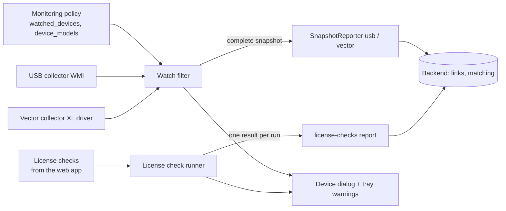

# Bench device and license monitoring (agent design)

**Status:** License checks: implemented in the agent (generic runner, Vector preset, tray warnings, device dialog; uses the backend routes once they exist). Device links and watch list: proposed (2026-11-18). Backend contract: lab-mango
`docs/proposals/agent-bench-devices-and-licenses.md` (T2, needs owner approval).
**Builds on:** the USB collector and `DeviceObservationReporter` (`src/core/monitoring/`).

## 1. Goals

1. Monitor only what matters: equipment that belongs on this computer's bench, plus *additional*
   lab equipment plugged in. Mice, keyboards, phones and personal sticks never leave the computer.
2. Identify equipment by what the hardware reports, not by the inventory's `serial_number`, which
   is typed by people (part numbers, USB product IDs, labels) and does not match the device.
3. Read tool licenses held by lab hardware or by the computer (first: Vector), so the backend
   keeps `License.expiry_date` / `max_version` current and warns before expiry.
4. Show both in the tray app: warnings and the device dialog.

## 2. Identity: hardware IDs and device links

The agent reports **hardware IDs**: values read from the device. A coordinator **links** each
physical unit's hardware ID to its inventory record once, in the web app. Matching, the bench
watch list and license carriers all use links; `serial_number` remains a human label.

| Kind | Read from | Value | Notes |
|---|---|---|---|
| `usb_serial` | Windows USB instance ID when the device has a serial descriptor | `VID:PID:serial` | Unique per device, any computer, any port |
| `vector_device` | Vector XL Driver Library | `<article>-<serial>`, e.g. `007113-585343` | Same serial as Vector Hardware Config |
| `usb_port` | Windows instance ID when the device has no serial (Windows adds `&…`) | full instance ID | Changes with the USB port; valid only on this computer |
| model | USB vendor and product ID | `VID:PID` | Not an identity: tells *what* it is, not *which one* |

Rules in `src/core/monitoring/devices.py`: an instance ID whose last segment contains `&` is a
Windows-generated port ID, never a serial; values are upper-case; at most 4 IDs per device.

### Linking flow

1. A CANcase is plugged into the bench computer for the first time. Its model `1248:1073` is a lab
   model, so the agent reports it with its hardware IDs (an *additional*, unlinked device).
2. The backend suggests the bench's unlinked VN1630A units; the coordinator confirms "CANcase 3".
3. The next policy lists CANcase 3 in `watched_devices` with its hardware IDs. From then on it is
   matched wherever it is plugged in, and its licenses attach to it.

## 3. What the agent reports

| Device | Reported | Backend sees |
|---|---|---|
| Hardware ID in `watched_devices` | yes | the bench unit, connected |
| Watched unit not connected | absent from the complete snapshot | the bench unit, disconnected (missing) |
| Lab model (`device_models`), not watched | yes | additional device: linked unit from elsewhere, or unlinked with link suggestions |
| Anything else | no | — |



Compatibility: with a backend that sends no watch list yet, the agent keeps today's behaviour.

## 4. Collectors

| Collector | Source | Reports | Needs |
|---|---|---|---|
| `usb` | WMI `Win32_PnPEntity` (exists) | watched / lab-model USB devices with hardware IDs and VID:PID | — |
| `vector` | Vector XL Driver Library (`vxlapi64.dll`, via `ctypes`) | Vector interfaces: hardware type, serial, channels | Vector driver installed |
| license checks | configured per computer in the web app (presets: Vector License Client) | licenses per carrier, one result per run | see 4.2 |

### 4.1 Vector devices

`xlOpenDriver` → `xlGetDriverConfig` (channels with hardware type, index and serial) →
`xlCloseDriver`; channels grouped by serial into one device with `vector_device` and, when the
USB entry is found, `usb_serial`. Read-only: no ports opened, no configuration changed.

### 4.2 License checks

Licenses are read by **license checks** configured in the Lab Mango web app (backend proposal,
section 5). The agent implements a closed catalog of read-only probes; a check is data only:

| Part | Options |
|---|---|
| Probe | `command` (installed tool, fixed args, stdout), `file` (license/status file), `registry` (values under one HKLM key) |
| Extraction | `xml` (ElementTree path), `json` (dotted path with `[*]`), `text` (regex with named groups), `values` (registry); field sources for product, product code, version, expiry, final expiry, carrier ID, vendor license ID, reactivatable, carrier type; date formats; "never" values |
| Carrier | `computer`, `device` / `dongle` (hardware ID kind + `carrier_id`), `server`, `equipment` (unit chosen in the web app), or `mapped` per license from a tool field |

**Push by license serial.** The agent does not decide which Lab Mango license a result belongs to:
it pushes every license it finds with its `license_serial` (the tool's own license ID) and carrier;
the backend finds the `License` whose `identifier` is that serial, compares expiry, version and
carrier, and updates it (backend proposal, section 5.4). The observation key is a digest of the
serial, so a license keeps its identity when its dongle or device moves to another computer.
Licenses without a serial fall back to product-code matching on the backend.

The backend updates a license only if the report is plausible for this computer: the carrier is this
computer, a unit placed on its bench, or a unit this computer's agent reports as **connected** in its
device observations; and the license is assigned to that carrier or to this computer (backend
proposal, section 5.4, decision D8). For a license on a CANcase borrowed from another bench, the
"connected" rule is what applies, so the Vector device collector (4.1) must report the device with
the same hardware ID the License Client gives (`DeviceName`, kind `vector_device`).

Where the checks come from: `GET /agent/license-checks` when the backend advertises
`license_checks`; until then the presets enabled in `licenses.builtin_checks` (local settings).
Each check runs on its own interval (≥ 15 minutes); the scheduler wakes every 15 minutes. A changed
`revision` runs at once. A failed run keeps the last known licenses for the UI and reports the
failure; only an `ok` run replaces the license set.

**Local safety rules** (`src/core/licensing/probes.py`), not overridable by the backend:

| Rule | Detail |
|---|---|
| No shell | `subprocess.run([exe, *args])`, no window, stdin closed, cwd = tool folder |
| Bounds | ≤ 16 args of ≤ 256 chars, timeout ≤ 60 s, output and files ≤ 4 MiB, ≤ 500 licenses |
| Folders | Executables and files: absolute, under Program Files, Program Files (x86), ProgramData or `licenses.allowed_roots` |
| Untrusted connection | While `tls.verify` is off, configured paths are refused (`rejected` / `untrusted_connection`) unless they are trusted defaults: preset executables, `licenses.vector_license_client`, `licenses.trusted_paths` |
| Registry | HKLM, read only |

**Vector preset** (`src/core/licensing/presets.py`): `Vector.LicenseClient -listlicenses`
(Vector KB0021758), fixture `tests/licensing/fixtures/listlicenses_device_perpetual.xml`.

| Element | Mapped to |
|---|---|
| `ProductText`, `MaterialNumber`, `MaxVersion` | product name, product code, max version |
| `ExpirationDateString` | `expires_at`: when the activation ends (reactivatable licenses) |
| `FinalExpirationDateString` | `final_expires_at`; `9999-12-31` = perpetual |
| `BindingType` + `DeviceName` | carrier: DEVICE → device, DONGLE → dongle, PC → computer; hardware ID `vector_device` = `DeviceName` |
| `VectorLicenseId` | `license_serial`: the backend's match key for `License.identifier`; never logged or shown |
| `IsReactivatable` | warning text: "Reactivate it in the vendor's license tool." |

The output declares `encoding="Codepage - 437"` (not a valid XML encoding); `encoding: auto` maps it
to cp437. Other tools (FlexNet `lmutil`, CodeMeter, license files) become presets the same way: capture
the tool's output on a lab computer, write the mapping, add the capture as a test fixture.

Open: the Vector legacy (hardware-based) licenses are only visible in Vector Hardware Config; a
probe for them needs a tool with readable output (to be identified). The device name format
(`<article>-<serial>`) should be confirmed so the Vector device collector produces the same ID.

### 4.3 Data

`src/core/licensing/models.py`: `LicenseObservation` (check key, observation key, vendor, product
code/name, carrier type, carrier hardware ID or equipment UID, `expires_at`, `final_expires_at`, max
version, reactivatable, vendor license ID) and `CheckResult` (check key, revision, status `ok` /
`not_installed` / `failed` / `rejected`, error code and message, duration, licenses). Report body:
`src/core/licensing/report.py`.

## 5. Code layout

```
src/core/licensing/          Qt-free, unit tested
  checks.py                  LicenseCheck and validation (the configuration contract)
  extract.py                 decoding and declarative extraction (xml / json / text / values)
  probes.py                  command / file / registry readers and the SafetyPolicy
  runner.py                  run_check(): probe -> extract -> CheckResult, never raises
  presets.py                 built-in templates (Vector License Client)
  report.py                  report body for the backend
  models.py                  LicenseObservation, CheckResult, CarrierType, CheckStatus
src/core/monitoring/         devices, hardware IDs, device observation reporter
src/app/controller/monitoring/
  license_collector.py       which checks to run, intervals, last results, warnings, reporting
  monitoring_ctrl.py         schedules license checks every 15 minutes
tests/licensing/             validation, extraction (real Vector sample), safety rules, a real process
```

## 6. User interface (tray app)

- **Device dialog**: each device shows its link: "CANcase 3 (this bench)", "CANcase 7 (bench B7,
  additional)" or "Not linked — link it in Lab Mango" with a button that opens the unit's page.
  Hardware IDs are shown so an admin can tell the coordinator which device it is.
- **License checks in the device dialog** (implemented as a list in the dialog's log; a table needs
  a `.ui` change): each check with its source (web app or built-in) and last status, and the
  licenses it found with carrier, expiry, version and days left.
- **Tray warning** (implemented) when a license on this computer or a connected device expires
  within `licenses.warn_days` (30) days, at most once a day per license, for example
  "CANalyzer PRO on 007113-585343 expires in 10 days (09 Apr 2027). Reactivate it in the Vector
  License Client."

Linking itself stays in the web app: the agent is authenticated as a device, not as a coordinator.

## 7. Failure behaviour

| Situation | Behaviour |
|---|---|
| Tool, file or registry key missing | Check result `not_installed`; other checks continue |
| Timeout or unreadable output | `failed` with `timeout` / `parse_error`; last known licenses kept; never a partial complete list |
| Configuration breaks a local rule | `rejected` with the reason, reported to the web app |
| Backend without license checks | Built-in presets from local settings; results stay local |
| Backend without the device fields | Previous behaviour for devices |
| Device moved to another USB port | `usb_serial` / `vector_device` still match; a `usb_port`-only device needs a new link (shown in the dialog) |

## 8. Delivery

| Phase | Agent | Backend | Done when |
|---|---|---|---|
| 1 | Hardware IDs; watch filter; Vector device collector; link status in the dialog | Links, suggestions, link matching, `usb_ids`, watch list | Bench units show connected/missing by link; additional devices get suggestions |
| 2 | **Done:** generic check runner, safety rules, Vector preset, reporting client, tray warnings | License checks (model, admin UI, routes), runs, observations, matching | A check configured in the web app runs on its computers and its licenses show on the license records |
| 3 | More presets from captured output (FlexNet, CodeMeter, license files); license table in the dialog | Expiry/version updates (D1), notifications, "found on lab hardware" | Lab Mango expiry dates follow the tools |
