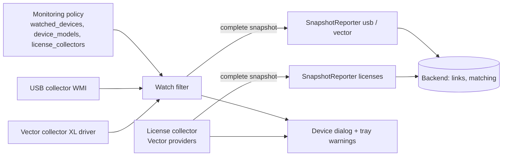

# Bench device and license monitoring (agent design)

**Status:** Proposed (revised 2026-11-18). Backend contract: lab-mango
`docs/proposals/agent-bench-devices-and-licenses.md` (T2, needs owner approval).
**Builds on:** the USB collector and `DeviceObservationReporter` (`src/core/monitoring/`).

## 1. Goals

1. Monitor only what matters: equipment that belongs on this computer's bench, plus *additional*
   lab equipment plugged in. Mice, keyboards, phones and personal sticks never leave the computer.
2. Identify equipment by what the hardware reports, not by the inventory's `serial_number`, which
   is typed by people (part numbers, USB product IDs, labels) and does not match the device.
3. Read tool licenses held by lab hardware or by the computer (first: Vector), so the backend
   keeps `License.expiry_date` / `max_version` current and warns before expiry.
4. Show both in the tray app: warnings and the device dialog.

## 2. Identity: hardware IDs and device links

The agent reports **hardware IDs**: values read from the device. A coordinator **links** each
physical unit's hardware ID to its inventory record once, in the web app. Matching, the bench
watch list and license carriers all use links; `serial_number` remains a human label.

| Kind | Read from | Value | Notes |
|---|---|---|---|
| `usb_serial` | Windows USB instance ID when the device has a serial descriptor | `VID:PID:serial` | Unique per device, any computer, any port |
| `vector_serial` | Vector XL Driver Library | `<hardware type>:<serial>` | Same serial as Vector Hardware Config |
| `usb_port` | Windows instance ID when the device has no serial (Windows adds `&…`) | full instance ID | Changes with the USB port; valid only on this computer |
| model | USB vendor and product ID | `VID:PID` | Not an identity: tells *what* it is, not *which one* |

Rules in `src/core/monitoring/devices.py`: an instance ID whose last segment contains `&` is a
Windows-generated port ID, never a serial; values are upper-case; at most 4 IDs per device.

### Linking flow

1. A CANcase is plugged into the bench computer for the first time. Its model `1248:1073` is a lab
   model, so the agent reports it with its hardware IDs (an *additional*, unlinked device).
2. The backend suggests the bench's unlinked VN1630A units; the coordinator confirms "CANcase 3".
3. The next policy lists CANcase 3 in `watched_devices` with its hardware IDs. From then on it is
   matched wherever it is plugged in, and its licenses attach to it.

## 3. What the agent reports

| Device | Reported | Backend sees |
|---|---|---|
| Hardware ID in `watched_devices` | yes | the bench unit, connected |
| Watched unit not connected | absent from the complete snapshot | the bench unit, disconnected (missing) |
| Lab model (`device_models`), not watched | yes | additional device: linked unit from elsewhere, or unlinked with link suggestions |
| Anything else | no | — |



Compatibility: with a backend that sends no watch list yet, the agent keeps today's behaviour.

## 4. Collectors

| Collector | Source | Reports | Needs |
|---|---|---|---|
| `usb` | WMI `Win32_PnPEntity` (exists) | watched / lab-model USB devices with hardware IDs and VID:PID | — |
| `vector` | Vector XL Driver Library (`vxlapi64.dll`, via `ctypes`) | Vector interfaces: hardware type, serial, channels | Vector driver installed |
| licenses `vector` | XL driver (legacy licenses) + Vector License Client (new model) | licenses per carrier | see 4.2 |

### 4.1 Vector devices

`xlOpenDriver` → `xlGetDriverConfig` (channels with hardware type, index and serial) →
`xlCloseDriver`; channels grouped by serial into one device with `vector_serial` and, when the
USB entry is found, `usb_serial`. Read-only: no ports opened, no configuration changed.

### 4.2 Vector licenses

| Provider | License model | Read through | Gives |
|---|---|---|---|
| `VectorHardwareLicenseProvider` | Legacy, hardware-based (shown in Vector Hardware Config) | XL Driver Library `xlGetLicenseInfo` | license names on the device; perpetual |
| `VectorLicenseClientProvider` | New Vector License Model | Vector License Client command-line tool | product code, valid versions, expiry, carrier (device, Keyman, computer) |

The carrier of a device or Keyman license is sent as a hardware ID (`vector_serial`), so the
backend finds the carrier through its link, never through `serial_number`.

**Blocking for implementation:** the License Client's list command and output format are not
publicly documented, and the XL function signatures must be checked against the installed
`vxlapi.h`. Capture on one lab computer: the License Client version, its help and list output
(licenses on a device, a Keyman and the computer), and the XL driver version. Parsers are written
against these captures, which become test fixtures.

### 4.3 License observation

```python
@dataclass(frozen=True)
class LicenseObservation:
    observation_key: str            # "vector:<carrier kind>:<carrier value or 'computer'>:<product_code>"
    vendor: str                     # "Vector"
    product_code: str               # e.g. "CANoe"
    product_name: str               # e.g. "CANoe pro"
    carrier_type: str               # device | dongle | computer
    carrier_hardware_id: HardwareId | None  # None for computer
    valid_until: date | None        # None = perpetual
    max_version: str
    state: str                      # valid | expired | not_activated
```

Never collected: activation keys, ticket IDs, license files. Licenses are read at start, every
6 hours and when a Vector device connects.

## 5. Code layout

```
src/core/monitoring/
  devices.py               HardwareId, ObservedDevice(hardware_ids, vendor_id, product_id)
  watch_list.py            WatchList.from_policy(), accepts(device), is_watched(device)
  snapshot_reporter.py     SnapshotReporter (generalised from reporter.py: devices and licenses)
  licenses.py              LicenseObservation, LicenseProvider protocol
src/core/vendors/vector/
  xl_driver.py             ctypes binding (Windows only, loaded lazily)
  devices.py               XL channel list -> ObservedDevice
  license_client.py        runs the License Client CLI, parses its output
  licenses.py              both providers -> LicenseObservation
src/app/controller/monitoring/
  vector_device_collector.py
  license_collector.py
tests/vendors/vector/fixtures/   captured outputs (4.2)
```

## 6. User interface (tray app)

- **Device dialog**: each device shows its link: "CANcase 3 (this bench)", "CANcase 7 (bench B7,
  additional)" or "Not linked — link it in Lab Mango" with a button that opens the unit's page.
  Hardware IDs are shown so an admin can tell the coordinator which device it is.
- **License table** in the same dialog: license, carrier, valid until, version, state.
- **Tray warning** when a license on this computer or a connected device expires within 30 days,
  once a day per license.

Linking itself stays in the web app: the agent is authenticated as a device, not as a coordinator.

## 7. Failure behaviour

| Situation | Behaviour |
|---|---|
| Vector driver or License Client not installed | That source reports nothing, logged once; others continue |
| CLI timeout (> 10 s) or unparsable output | No snapshot sent (never a partial "complete" one); retried next cycle |
| Backend without the new fields or route | Previous behaviour for devices; license collector off |
| Device moved to another USB port | `usb_serial` / `vector_serial` still match; a `usb_port`-only device needs a new link (shown in the dialog) |

## 8. Delivery

| Phase | Agent | Backend | Done when |
|---|---|---|---|
| 1 | Hardware IDs; watch filter; Vector device collector; link status in the dialog | Links, suggestions, link matching, `usb_ids`, watch list | Bench units show connected/missing by link; additional devices get suggestions |
| 2 | License providers (after 4.2 captures), license reporter | License route, projection, matching | A CANcase's licenses show on its license records |
| 3 | Tray warnings, license table | Expiry/version updates (D1), notifications | Lab Mango expiry dates follow the hardware |
