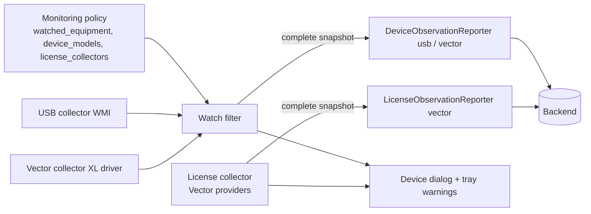

# Bench device and license monitoring (agent design)

**Status:** Proposed (2026-11-18). Backend contract: lab-mango
`docs/proposals/agent-bench-devices-and-licenses.md` (T2, needs owner approval).
**Builds on:** the USB collector and `DeviceObservationReporter` (`src/core/monitoring/`).

## 1. Goals

1. Monitor only what matters: the equipment that belongs on this computer's bench, plus
   *additional* lab equipment plugged in (for example a CANcase borrowed from another bench).
   Ignore mice, keyboards, phones and personal USB sticks: they never leave the computer.
2. Read tool licenses held by lab hardware or by the computer (first: Vector), report product,
   version range, expiry and state, so the backend keeps `License.expiry_date` / `max_version`
   current and warns before a license expires.
3. Show both on the computer: the tray app warns the user and the device dialog lists them.

## 2. How the backend recognises equipment

The backend matches each reported device by **exact serial number + compatible interface**
against inventory (`Equipment.serial_number`, `Equipment.interfaces`). Results are `matched`,
`unmatched`, `ambiguous` or `interface_mismatch`. So the agent never needs inventory IDs: it must
report the serial the inventory holds. For Vector hardware that is the serial printed on the
device and shown in Vector Hardware Config, which the XL driver returns (section 4.1); the Windows
USB instance ID may differ, so the Vector collector is the source for Vector serials.

## 3. Watch list: what the agent reports

The monitoring policy gains `watched_equipment` (units placed on this computer's bench) and
`device_models` (USB vendor/product IDs of lab equipment models). A connected device is reported
when **either**:

| Rule | Example | Backend result |
|---|---|---|
| Its serial is in `watched_equipment` | the bench's CANcase `025123` | `matched` to that unit |
| Its USB vendor/product ID is in `device_models` but the serial is not watched | a CANcase from bench 7 | additional device: `matched` to the other unit, or `unmatched` if not in inventory |

Everything else is dropped on the computer. Watched units that are *not* connected are absent
from the complete snapshot, so the backend marks them disconnected: "the bench's CANcase is
missing" becomes visible without extra protocol.



Compatibility: while the backend does not send `watched_equipment` (older backend), the agent keeps
today's behaviour (report every USB device with a serial) so nothing regresses.

## 4. Collectors

| Collector key | Source | Reports | Needs |
|---|---|---|---|
| `usb` | WMI `Win32_PnPEntity` (exists) | Watched / known-model USB devices | — |
| `vector` | Vector XL Driver Library (`vxlapi64.dll`) | Vector interfaces: serial, hardware type, channels | Vector driver setup installed |
| `vector` (licenses) | XL driver (legacy) + Vector License Client (new model) | Licenses per carrier | see 4.2 |

### 4.1 Vector devices (XL Driver Library)

Loaded with `ctypes` from the installed driver; no extra Python dependency. `xlOpenDriver` →
`xlGetDriverConfig` (channel list with hardware type, index, serial number, transceiver) →
`xlCloseDriver`. Channels are grouped by serial into one device. Reported as
`interface_name = "USB"` (the catalog spelling is applied), `name = "<hardware type> <serial>"`.
Read-only: the agent never opens ports or changes the driver configuration.

### 4.2 Vector licenses

Vector has two license models; the agent supports both behind one interface:

| Provider | License model | Read through | Gives |
|---|---|---|---|
| `VectorHardwareLicenseProvider` | Legacy, hardware-based (shown in Vector Hardware Config) | XL Driver Library `xlGetLicenseInfo` per device | license names available on the device; no expiry (perpetual) |
| `VectorLicenseClientProvider` | New Vector License Model (Vector License Client) | the License Client command-line tool | product code, valid versions, expiry date, carrier (device, Keyman, computer) |

**Not verified yet (blocking for implementation):** Vector documents the License Client as a
command-line tool for administering licenses and showing expiration, product code and valid
versions, but the exact list command and its output format are not public. The XL function
signature must be checked against the installed `vxlapi.h`. Before coding the providers, capture on
one lab computer: the License Client version, the output of its help and list commands (with a
license on a device, on a Keyman and on the computer), and the installed XL driver version.
The parsers are then written against those captures and kept as test fixtures.

### 4.3 License observation

```python
@dataclass(frozen=True)
class LicenseObservation:
    observation_key: str      # "vector:<carrier_type>:<carrier_serial or 'computer'>:<product_code>"
    vendor: str               # "Vector"
    product_code: str         # e.g. "CANoe"
    product_name: str         # e.g. "CANoe pro"
    carrier_type: str         # device | dongle | computer
    carrier_serial: str       # "" for computer
    valid_until: date | None  # None = perpetual
    max_version: str          # "" when unknown
    state: str                # valid | expired | not_activated
```

Never collected: activation keys, ticket IDs, license file contents. Reporting reuses the
`DeviceObservationReporter` mechanics (complete snapshots, persisted batch, idempotency key,
clock-based sequence), generalised as `SnapshotReporter` with two payload kinds. Licenses are read
every 6 hours, at start, and when a Vector device is connected.

## 5. Code layout

```
src/core/monitoring/
  snapshot_reporter.py     SnapshotReporter (generalised from reporter.py)
  watch_list.py            WatchList.from_policy(), WatchList.accepts(device)
  licenses.py              LicenseObservation, LicenseProvider protocol
src/core/vendors/vector/
  xl_driver.py             ctypes binding: driver config, license info (Windows only, lazy load)
  devices.py               XL channel list -> ObservedDevice
  license_client.py        runs the License Client CLI, parses its output
  licenses.py              both providers -> LicenseObservation
src/app/controller/monitoring/
  vector_device_collector.py
  license_collector.py
tests/vendors/vector/fixtures/   captured outputs (section 4.2)
```

`src/core/vendors/<vendor>/` keeps vendor specifics out of the generic monitoring code, so another
vendor (for example a dSPACE or ETAS license source) is one more provider.

## 6. User interface (tray app)

- **Tray warning** when a license on this computer or a connected device expires within 30 days,
  once per day per license: "CANoe on CANcase 025123 expires on 31 Mar 2027".
- **Device dialog** (`DeviceScanView`) gains a second table: license, carrier, valid until,
  version, state. The device table shows whether each device is on this bench or additional.

## 7. Failure behaviour

| Situation | Behaviour |
|---|---|
| Vector driver or License Client not installed | Collector reports nothing for that source and logs once; other collectors continue |
| CLI times out (> 10 s) or output cannot be parsed | Snapshot not sent (never a partial "complete" snapshot); retried next cycle |
| Backend without the license route (`/agent/info` capability missing) | License collector stays off |
| Not enrolled | Collectors run for the local UI only |

## 8. Delivery

| Phase | Agent | Backend | Done when |
|---|---|---|---|
| 1 | Watch filter; Vector device collector | Policy watch list, `usb_ids` | Only bench + additional devices reach the backend; Vector serials match inventory |
| 2 | License providers (after the captures in 4.2), license reporter | License route, projection, matching | Licenses on a CANcase show as matched on its license |
| 3 | Tray warnings, license table | Expiry/version updates (decision D1), notifications | Expiry date in Lab Mango follows the hardware |
